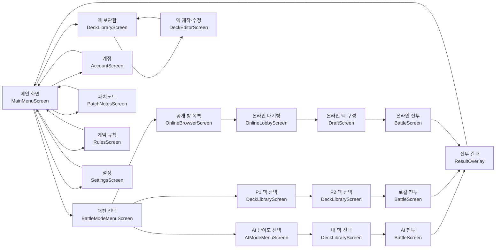

# 장면 구성

아래 흐름을 최고의TCGidea의 장면 분리 기준으로 사용한다.



## 원칙

- `main.tscn`은 공통 화면 틀과 화면 전환을 담당한다.
- 각 화면은 독립된 `.tscn`과 스크립트를 가진다.
- 덱 보관함은 관리 모드와 전투용 선택 모드에서 공용으로 사용한다.
- 전투 화면은 AI, 로컬, 온라인 모드가 공용으로 사용한다.
- 카드 미리보기, 체인, 전투 결과와 연출은 화면 위에 표시되는 오버레이 장면으로 분리한다.
- 설정과 게임 규칙은 팝업이 아닌 독립 화면으로 이동한다.

## 현재 장면 파일

- `src/scenes/main.tscn`: 게임 루트와 `ScreenHost`
- `src/scenes/screens/main_menu/main_menu.tscn`: 메인 화면
- `src/scenes/screens/menu/battle_mode_menu.tscn`: 대전 방식 선택
- `src/scenes/screens/menu/ai_mode_menu.tscn`: AI 난이도 선택
- `src/scenes/screens/patch_notes/patch_notes_screen.tscn`: 패치노트
- `src/scenes/screens/account/account_screen.tscn`: 계정
- `src/scenes/screens/online/online_browser_screen.tscn`: 공개 방 목록
- `src/scenes/screens/online/online_lobby_screen.tscn`: 온라인 대기방
- `src/scenes/screens/decks/deck_library_screen.tscn`: 덱 보관함과 덱 선택
- `src/scenes/screens/decks/deck_editor_screen.tscn`: 덱 제작과 수정
- `src/scenes/screens/draft/draft_screen.tscn`: 12장 덱 구성
- `src/scenes/screens/battle/battle_screen.tscn`: AI, 로컬, 온라인 공용 전투
- `src/scenes/screens/settings/settings_screen.tscn`: 설정
- `src/scenes/screens/rules/rules_screen.tscn`: 게임 규칙
- `src/scenes/overlays/result_overlay/result_overlay.tscn`: 전투 결과와 보드 확인 오버레이

모든 화면은 `main.tscn`의 `ScreenHost` 안에 한 번에 하나씩 장착된다.

## 컨트롤러 구성

```text
main.gd
└─ battle_action_controller.gd
   └─ battle_screen_controller.gd
      └─ battle_input_effects_controller.gd
         └─ deck_screen_controller.gd
            └─ online_screen_controller.gd
               └─ account_screen_controller.gd
                  └─ start_screen_controller.gd
                     └─ app_controller.gd
```

- `main.gd`: 현재 화면 선택과 전체 갱신
- `app_controller.gd`: 공통 상태, 초기화, 공용 UI 도구
- `start_screen_controller.gd`: 메인, 모드 선택, 패치노트, 설정, 규칙
- `account_screen_controller.gd`: 로그인, 회원가입, 계정과 클라우드 덱 동기화
- `online_screen_controller.gd`: 방 목록, 대기방, 접속과 전투 동기화
- `deck_screen_controller.gd`: 저장 덱, 덱 편집, 덱 구성, 게임 시작
- `battle_input_effects_controller.gd`: 드래그 입력, 화살표, 미리보기와 전투 연출
- `battle_screen_controller.gd`: 필드, 체인, 패와 전투 오버레이 표시
- `battle_action_controller.gd`: 공격, 소모 효과, 주문과 대상 선택 처리

위 파일들은 상속 순서로 하나의 게임 컨트롤러처럼 동작한다. `main.gd`에는 화면의 세부 구현을 다시 넣지 않는다.
